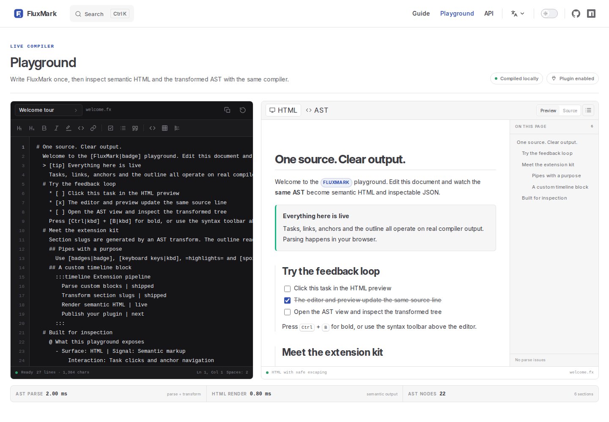

# FluxMark

**English** · [简体中文](./README.zh-CN.md)

[](https://www.npmjs.com/package/fluxmark)
[](./LICENSE)

FluxMark is a lightweight TypeScript compiler for structured documents. It turns readable, indentation-based source into a typed AST and accessible semantic HTML, with a plugin pipeline that stays out of your way. The SDK has no runtime dependencies.

[Documentation](https://okysu.github.io/fluxmark/) · [Playground](https://okysu.github.io/fluxmark/playground) · [Quick start](https://okysu.github.io/fluxmark/guide/getting-started) · [API](https://okysu.github.io/fluxmark/api/)



## Why FluxMark

- **Write less structure.** Physical indentation creates sections, callouts, lists and code blocks. There are no closing tags to maintain.
- **Predictable parsing.** Inline delimiters and pipe expressions are paired in precomputed linear passes, not repeated backtracking searches.
- **Typed by design.** Every node keeps source locations and ranges. Visit, filter or replace nodes with a fully typed AST walker.
- **Extensible at every stage.** Add block rules, pipe modifiers, AST transforms and HTML renderers through one plugin interface.
- **Accessible output.** Compile to clean semantic HTML with strict escaping, URL allowlisting and a polished default stylesheet.
- **Interactive by default.** Task checkboxes and live Playground examples share the same compiler and can update their original source.
- **Bilingual documentation.** Full English and Chinese guides, API reference and a live Playground built with VitePress.

## Install

```bash
npm install fluxmark
```

```bash
pnpm add fluxmark
```

Requires Node.js 18 or later for parsing and HTML rendering.

## Quick start

```ts
import { FluxMark } from 'fluxmark'
import 'fluxmark/styles.css'

const flux = new FluxMark()
const source = `# Release notes
  FluxMark turns [structured content|b] into a typed AST.
  > [tip] One source, clear output
    The same document can be inspected as HTML or JSON.
  * [x] Parse the document
  * [ ] Publish the package
`

const ast = flux.parse(source)
const html = flux.renderToHTML(ast)

console.log(ast.issues, html)
```

The source above renders a section, a styled paragraph, a callout and an interactive task list. `parse` produces a `FluxDocument`; `renderToHTML` compiles it to semantic markup.

## A small language, with useful depth

```text
# Project status
  A paragraph with *bold*, _italic_, =highlight= and ~strike~.
  Links use [pipe modifiers|https://example.com,?Optional tooltip].

  > [warn] Nested content
    Indented lines belong to the callout automatically.

  @ Release table
    - Package: fluxmark | Status: Stable
      Owner: Core team

  $ ts
    const ast = parseFluxMark(source)

  1. Parse
  2. Render
  * [ ] Unfinished task
  * [x] Completed task
  ---
```

Pipe modifiers combine styles, colors, links and tooltips in one expression: `[text|b,i,#3451b2,https://example.com,?Help text]`. Custom modifiers such as `kbd`, `badge` and `spoiler` are available to the HTML renderer or your own plugins.

## Plugins

One small plugin can extend parsing, transformation and rendering:

```ts
import { FluxMark, createFluxNodeBase, walkAST } from 'fluxmark'
import type { FluxPluginDefinition } from 'fluxmark'

const mathPlugin: FluxPluginDefinition = {
  name: 'math',
  blockRules: [
    {
      name: 'math',
      parse({ line }) {
        if (!line.content.startsWith('! math ')) return null
        return {
          node: {
            ...createFluxNodeBase(line),
            type: 'CustomBlock',
            name: 'math',
            content: line.content.slice(7),
            attributes: {},
            children: [],
          },
        }
      },
    },
  ],
  astTransforms: [
    (document) => {
      walkAST(document, {
        Section: {
          enter(section) {
            section.id = section.title.map((token) => token.content).join('-')
          },
        },
      })
    },
  ],
  htmlRenderers: {
    CustomBlock(node, _children, helper) {
      if (node.name !== 'math') return helper.defaultRender()
      return `<output data-kind="math">${helper.escapeHtml(node.content)}</output>`
    },
  },
}

const flux = new FluxMark().use(mathPlugin)
```

The plugin API also supports typed factories, custom callout variants, pipe modifiers and renderer overrides. Learn more in the [plugin guide](https://okysu.github.io/fluxmark/guide/plugins).

## Semantic HTML you can trust

`FluxHtmlRenderer` escapes text and attributes, validates URLs against an explicit protocol allowlist and emits accessible markup out of the box. Override any block node or inline token without rewriting the renderer:

```ts
import { FluxHtmlRenderer } from 'fluxmark'

const renderer = new FluxHtmlRenderer({
  overrides: {
    Section(node, _children, helper) {
      return `<div class="section" data-level="${node.level}">${helper.defaultRender()}</div>`
    },
  },
})
```

The stylesheet is available from `fluxmark/styles.css` or as a string through `getFluxDefaultStyles()`.

## Explore in the browser

The [Playground](https://okysu.github.io/fluxmark/playground) compiles source entirely in the browser. Edit a document and switch between semantic HTML, formatted source and the transformed AST, with parse and render timings at the bottom.

The [language guide](https://okysu.github.io/fluxmark/guide/syntax) embeds interactive examples directly below key syntax sections, so every feature can be inspected without leaving the documentation.

## Documentation

- [Getting started](https://okysu.github.io/fluxmark/guide/getting-started)
- [Language syntax](https://okysu.github.io/fluxmark/guide/syntax)
- [Plugins](https://okysu.github.io/fluxmark/guide/plugins)
- [AST walker](https://okysu.github.io/fluxmark/guide/walker)
- [HTML renderer](https://okysu.github.io/fluxmark/guide/renderers)
- [API reference](https://okysu.github.io/fluxmark/api/)
- [中文文档](https://okysu.github.io/fluxmark/zh/)

## Contributing

Issues and pull requests are welcome. See [CONTRIBUTING.md](./CONTRIBUTING.md) for local setup and verification commands.

## License

[MIT](./LICENSE) © FluxMark contributors
