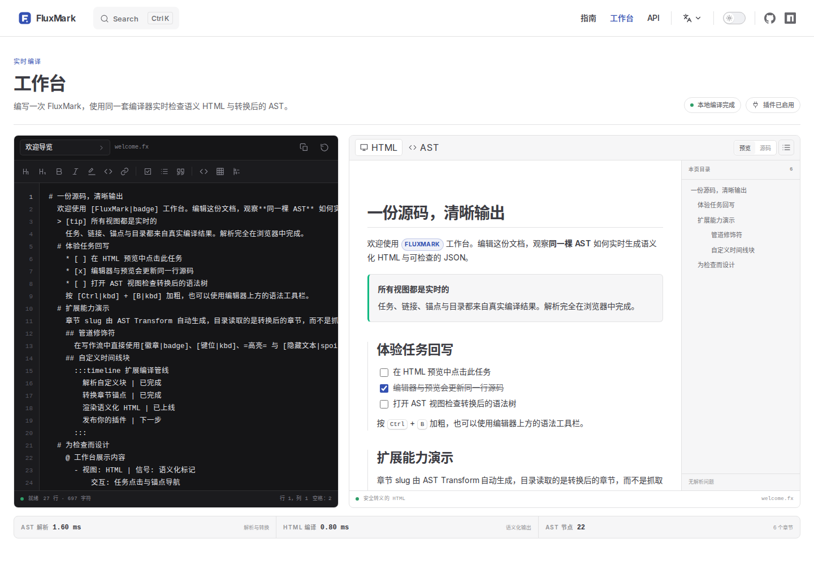

# FluxMark

[English](./README.md) · **简体中文**

[](https://www.npmjs.com/package/fluxmark)
[](./LICENSE)

FluxMark 是一个面向结构化文档的轻量 TypeScript 编译器。它将易读的缩进式源码编译为类型化 AST 与无障碍语义化 HTML，并提供清晰的插件管线。SDK 没有运行时依赖。

[在线文档](https://okysu.github.io/fluxmark/zh/) · [交互工作台](https://okysu.github.io/fluxmark/zh/playground) · [快速上手](https://okysu.github.io/fluxmark/zh/guide/getting-started) · [API](https://okysu.github.io/fluxmark/zh/api/)



## 为什么选择 FluxMark

- **更少的结构噪音。** 物理缩进直接表达章节、容器、列表与代码块，不需要维护闭合标签。
- **可预测的解析。** 行内定界符与管道表达式通过预计算线性扫描完成配对，不重复回溯搜索。
- **类型化设计。** 每个节点都保留源码行列与范围，可通过完整的类型安全 Walker 遍历、过滤或替换。
- **每个阶段都可扩展。** 通过统一插件接口注册块级规则、管道修饰符、AST Transform 与 HTML 渲染器。
- **可靠的语义化输出。** 生成干净、无障碍的 HTML，内置严格转义、URL 白名单与完整的默认样式。
- **原生图片支持。** 使用 `![src|alt]`，`alt` 可省略；默认懒加载，并复用链接的 URL 安全策略。
- **默认可交互。** 任务复选框与文档内实时示例共享同一套编译器，并可回写原始源码。
- **完整中英双语。** 指南、API 参考与基于 VitePress 的实时工作台均提供中英文版本。

## 更短的源码，更快的渲染

基准覆盖 24 篇固定版本的公开 Markdown 文档，约 14 万词、1.04 MB 归一化源码，包括图文链接密集 README、技术规范、普通文档和大型 API 参考。

| 公开语料 | 文档数 | 源码字符数 | HTML 渲染对比 markdown-it | 对比 marked |
| --- | ---: | ---: | ---: | ---: |
| 图文/链接密集 README | 9 | 少 2.77% | 2.23× | 1.53× |
| 权威技术规范 | 3 | 少 0.34% | 1.35× | 1.46× |
| 普通说明文档 | 6 | 少 0.75% | 1.43× | 1.38× |
| 大型 API 参考 | 6 | 少 0.04% | 1.40× | 1.37× |
| 全部文档 | 24 | 少 0.23% | 1.44× | 1.31× |

所有语料类型的源码字符数都更少。紧凑表格在第一行声明列名，后续行只写值；链接、强调和块级标记也保持简短，字段不固定的记录仍可使用键值表。所有分类下 HTML 渲染都更快，在无表格正文语料上还比 snarkdown 快 1.23 倍。图片使用原生图片节点；raw HTML 因无法等价渲染而不参与比较。完整方法、统计与固定来源见[基准报告](./benchmarks/RESULTS.md)。

## 安装

```bash
npm install fluxmark
```

```bash
pnpm add fluxmark
```

解析与 HTML 渲染支持 Node.js 18 及以上版本。

## 快速开始

```ts
import { FluxMark } from 'fluxmark'
import 'fluxmark/styles.css'

const flux = new FluxMark()
const source = `# 版本说明
  FluxMark 将 [结构化内容|b] 编译为类型化 AST。
  > [tip] 一份源码，清晰输出
    同一份文档可以输出为 HTML 或检查其 JSON。
  * [x] 解析文档
  * [ ] 发布软件包
`

const ast = flux.parse(source)
const html = flux.renderToHTML(ast)

console.log(ast.issues, html)
```

上面的源码会生成章节、带样式的段落、提示容器与可交互任务列表。`parse` 返回 `FluxDocument`，`renderToHTML` 将其编译为语义化标记。

## 小而完整的语言

```text
# 项目状态
  这是包含 *粗体*、_斜体_、=高亮= 与 ~删除线~ 的段落。
  链接使用 [管道修饰符|https://example.com,?可选悬浮说明]。
  ![https://okysu.github.io/fluxmark/logo.svg|FluxMark 标志]

  > [warn] 嵌套内容
    缩进行会自动归属于容器。

  @ 发布状态
    - 软件包 | 状态 | 负责人
    - fluxmark | 稳定 | 核心团队

  $ ts
    const ast = parseFluxMark(source)

  1. 解析
  2. 渲染
  * [ ] 未完成任务
  * [x] 已完成任务
  ---
```

管道修饰符可以在一个表达式中组合样式、颜色、链接与提示：`[文本|b,i,#3451b2,https://example.com,?帮助信息]`。`kbd`、`badge` 与 `spoiler` 等自定义修饰符可直接用于 HTML 渲染器或自定义插件。

## 插件

一个小插件即可同时扩展解析、转换与渲染：

```ts
import { FluxMark, createFluxNodeBase, walkAST } from 'fluxmark'
import type { FluxPluginDefinition } from 'fluxmark'

const mathPlugin: FluxPluginDefinition = {
  name: 'math',
  blockRules: [
    {
      name: 'math',
      parse({ line }) {
        if (!line.content.startsWith('! math ')) return null
        return {
          node: {
            ...createFluxNodeBase(line),
            type: 'CustomBlock',
            name: 'math',
            content: line.content.slice(7),
            attributes: {},
            children: [],
          },
        }
      },
    },
  ],
  astTransforms: [
    (document) => {
      walkAST(document, {
        Section: {
          enter(section) {
            section.id = section.title.map((token) => token.content).join('-')
          },
        },
      })
    },
  ],
  htmlRenderers: {
    CustomBlock(node, _children, helper) {
      if (node.name !== 'math') return helper.defaultRender()
      return `<output data-kind="math">${helper.escapeHtml(node.content)}</output>`
    },
  },
}

const flux = new FluxMark().use(mathPlugin)
```

插件 API 还支持强类型工厂、自定义提示变体、管道修饰符与任意渲染覆写。详见[插件指南](https://okysu.github.io/fluxmark/zh/guide/plugins)。

## 可信赖的语义化 HTML

`FluxHtmlRenderer` 默认转义文本与属性，按明确协议白名单校验 URL，并输出无障碍语义标记。无需重写渲染器即可接管任意块级节点或行内 Token：

```ts
import { FluxHtmlRenderer } from 'fluxmark'

const renderer = new FluxHtmlRenderer({
  overrides: {
    Section(node, _children, helper) {
      return `<div class="section" data-level="${node.level}">${helper.defaultRender()}</div>`
    },
  },
})
```

样式表可通过 `fluxmark/styles.css` 引入，也可以通过 `getFluxDefaultStyles()` 获取字符串。

## 在浏览器中体验

[工作台](https://okysu.github.io/fluxmark/zh/playground)完全在浏览器中运行编译器。编辑文档后，可在语义化 HTML、格式化源码与转换后的 AST 之间切换，底部会显示解析与渲染耗时。

[语言指南](https://okysu.github.io/fluxmark/zh/guide/syntax)在关键语法下直接嵌入可交互示例，无需离开文档即可查看真实输出。

## 迁移 Markdown

仓库内置实验性转换工具，用于把存量 Markdown 转换为 FluxMark：

```bash
pnpm migrate path/to/article.md --output article.fx
```

它支持标题、段落、常见行内样式、链接、图片、列表、表格与代码块。由于 FluxMark 有意不支持 raw HTML，HTML 块会被统计并忽略。转换是规范化而非逐字节保真，发布前请检查生成结果。

## 文档

- [快速上手](https://okysu.github.io/fluxmark/zh/guide/getting-started)
- [语言语法](https://okysu.github.io/fluxmark/zh/guide/syntax)
- [插件系统](https://okysu.github.io/fluxmark/zh/guide/plugins)
- [AST 遍历](https://okysu.github.io/fluxmark/zh/guide/walker)
- [HTML 渲染器](https://okysu.github.io/fluxmark/zh/guide/renderers)
- [API 参考](https://okysu.github.io/fluxmark/zh/api/)
- [English documentation](https://okysu.github.io/fluxmark/)

## 参与贡献

欢迎提交 Issue 与 Pull Request。本地开发与验证命令见 [CONTRIBUTING.md](./CONTRIBUTING.md)。

## 许可证

[MIT](./LICENSE) © FluxMark contributors
